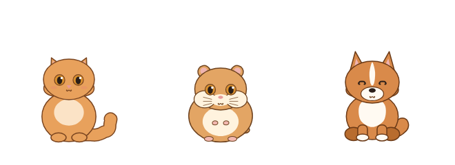

# Strays

**A desktop companion for your unfinished projects.** Each project you're working on gets a small animated pet that lives along the edge of your screen. Pushing commits feeds it. Leave a project alone and its pet gets hungry, then gloomy. Ship a release and it goes on holiday. Pets never die or age; only their mood changes.

> **Status:** pre-alpha, in active development. Private repository. macOS only for now (macOS 14 Sonoma or later). There is no installable release yet.

<p align="center">
  
</p>

## How it works

- **One pet per project.** Pick a cat, dog, hamster or parrot for each repository. Coat colours are set when the pet is adopted. By default you can keep 3 pets (configurable); other projects wait in a shelter.
- **Mood follows your activity.** It drops as days pass without a push: Joyful, Content, Peckish, Hungry, Gloomy. The day thresholds and pace are configurable. Holidays and paused time don't count, weekends can be excluded, and a failed sync never makes a mood worse.
- **Releases.** Mark a release and the pet celebrates, then takes a few days off-screen.
- **Snooze and pause.** Snooze hides a pet for a while (its hunger keeps counting). Pause is for deliberate breaks (its hunger freezes). Vacation mode pauses everyone.
- **Stays out of your way.**
  - Clicks pass straight through pets. Hold **⌥ Option** to interact.
  - Pets move aside for your frontmost window, hide over full-screen apps, and stay out of screen recordings and screen sharing.
  - At most 3 are on screen at once, neediest first.
  - The default **Calm** liveliness holds a still pose with an occasional blink. **Gentle** and **Lively** add more motion at a higher CPU cost.

| Input | Action |
|---|---|
| ⌥ + hover | Freeze pets, outline this one, show name · repo · mood |
| ⌥ + click | Open the pet's info card: mood, activity, goal checklist, and sync, snooze, release, pause, graduate |
| ⌥⇧ + click | Sync this pet now |

The modifier key can be changed in Settings. Every action is also in the 🐾 menu-bar menu.

See the [user guide](docs/user-guide.md) for setup, connecting GitHub, folders and removing the app.

## Privacy and permissions

Strays is local-first and asks for as little as possible.

- **No network** except GitHub, and only once you connect a token.
- **Read-only, expiring GitHub token.** A fine-grained token with only **Metadata: Read-only**: it can see when repos were pushed to, not their code. Classic tokens are rejected. The token is kept in the macOS Keychain and never reaches the app's web view.
- **Only `api.github.com`.** No other host is contacted, and redirects are never followed.
- **No `git` commands.** Local repositories are read directly (commit dates and remote URLs only). Strays never fetches, and never touches your credentials or SSH keys.
- **No special macOS permissions.** Cursor position, the ⌥ key and window bounds are all readable without Accessibility, Input Monitoring or Screen Recording.

## Architecture

```
app/core        Rust library: moods, pet states, settings, storage, GitHub client, local git, display rules.
                No Tauri dependency, so every rule is tested with a fake clock.
app/src-tauri   Tauri 2 app shell: background sync loop, Keychain, menu-bar menu, overlay window, macOS calls.
app/src         Overlay page and windows (TypeScript): draws pets with the Rive web runtime, plus the info card,
                settings, token setup and adoption screens.
art/<species>   Pet rigs generated as text (RML) by Python scripts and compiled with the Rive CLI.
                Shared poses and clips live in art/tools/pet.py; review sheets in art/review/.
tools/          Fake GitHub API server and an OS-level click-test harness.
native-overlay  Swift prototype from Gate 0, kept as a performance fallback.
docs/           Specification and gate reports.
```

The Rust side owns all state and decisions. The web view only renders what it's told and reports ⌥-clicks. State is stored as JSON files, written atomically, in the app's data folder.

## Development

**Prerequisites:** macOS 14+, Xcode Command Line Tools, Rust (stable), Node.js 22, Python 3 (tests only), and the [Rive CLI](https://rive.app) to rebuild art.

```bash
# Build the pet art (writes art/<species>/build/<species>.riv, which the app bundles)
for s in cat dog hamster parrot; do (python3 art/$s/make.py && cd art/$s && rive . --screenshot --advance=1); done

# Install front-end dependencies
cd app && npm install

# Core logic tests (unit, property and fake-GitHub tests)
cd app/core && cargo test

# Debug build of the app, with test hooks
cd app && npx tauri build --debug --no-bundle --features devtools
```

### Running a debug build

Debug builds read a GitHub token from `~/.config/strays/dev-token` when the Keychain has none. These variables exist only in debug builds:

| Variable | Effect |
|---|---|
| `STRAYS_DATA_DIR=<dir>` | Use a throwaway data folder |
| `STRAYS_SPAWN=<n>` | Add n test cats (not saved) |
| `STRAYS_FAKE_GITHUB=<url>` + `STRAYS_TOKEN=github_pat_fake` | Sync against `tools/fake-github/server.py` (needs `--features devtools`) |
| `STRAYS_CAPTURABLE=1` | Let screenshots capture the pets |
| `STRAYS_IGNORE_FRONT=1` | Pin placement, for repeatable performance runs |

```bash
STRAYS_DATA_DIR=/tmp/strays STRAYS_SPAWN=3 app/src-tauri/target/debug/Strays
```

### OS-level tests

```bash
tools/overlay-harness/click-test.sh   # real mouse and ⌥ events against the debug build
tools/overlay-harness/perf.sh B 600   # CPU and memory sample (set APP to the binary)
```

The click test takes over the mouse and keyboard for about a minute. It needs Accessibility access for the app that runs it, and the harness binary must be built first: `swiftc -O tools/overlay-harness/harness.swift -o tools/overlay-harness/harness`.

## Roadmap

Development runs through gates, each with measurable pass criteria (see [`docs/spec.md`](docs/spec.md) §14).

| Gate | Scope | Status |
|---|---|---|
| 0 | Prove the stack: Rive art authored by an agent, click-through overlay, CPU cost | ✅ Done ([report](docs/gate-0.md)) |
| 1 | Core logic, GitHub sync, local git | ✅ Done ([report](docs/gate-1.md)) |
| 2a | App shell, menu bar, sync loop, overlay | ✅ Done ([report](docs/gate-2.md)); Calm CPU budget set at ≤ 1.5% |
| 2b | Info card, settings, token setup, first run, local folders, nudges | ✅ Done ([report](docs/gate-2b.md)) |
| 3 | All four species, full animation set, sound, writing | In progress ([report](docs/gate-3.md)): cat, corgi and hamster done; parrot next |
| 4 | Signing, notarisation, packaging, release | Planned |

Windows support and cross-device sync are planned after the macOS release.

## License

Not yet licensed. All rights reserved.
