# Strays

<p align="center">
  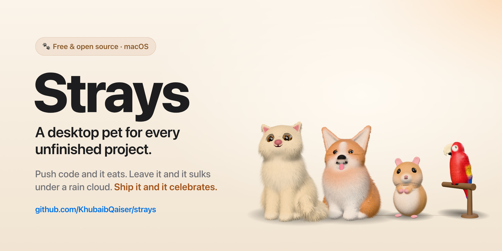
</p>

**A desktop companion for your unfinished projects.** Each project you're working on gets a small animated pet that lives along the edge of your screen. Pushing commits feeds it. Leave a project alone and its pet gets hungry, then gloomy. Ship a release and it goes on holiday. Pets never die or age; only their mood changes.

> **Status:** pre-alpha, in active development. macOS only for now: Apple Silicon Macs with macOS 14 Sonoma or later. **Intel Macs are not supported** ([why, and what adding them would cost](docs/gate-4.md#intel-macs)). There is no installable release yet.

## Watch it

<p align="center">
  <a href="docs/media/strays-launch.mp4">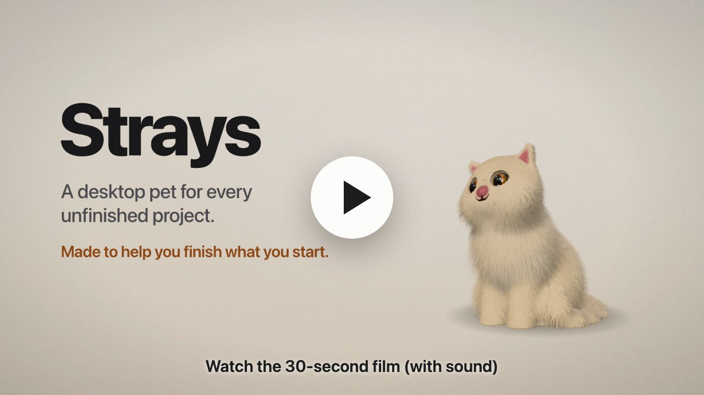</a>
</p>

A 30-second film, made from the app's own 3D pets: every project gets a pet, one project goes quiet for three weeks and its cat ends up lying under a rain cloud, then a push feeds it and a release makes it celebrate. ([MP4, 19 MB](docs/media/strays-launch.mp4), with sound; music by Sascha Ende, [ende.app](https://ende.app/en), CC BY 4.0.)

## Meet the strays

<p align="center">
  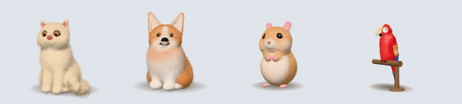
</p>

Four species, each a real-time 3D animal with a soft coat or feathers, drawn on your screen. Pick a coat when you adopt one: cream, charcoal, ginger, blue-grey or any colour (the macaw has its own scarlet, blue-and-gold, green and hyacinth).

| | Species | What it's like |
|---|---|---|
| 🐈 | **Cat**, a long-haired Persian | Faint tabby markings in a triple coat. Glances around, flicks its plume of a tail, purrs when petted. |
| 🐕 | **Dog**, a Pembroke Welsh Corgi | Fluffy bib and big ears. Wags, and pants with its tongue out when it's happy. |
| 🐹 | **Hamster**, a golden Syrian | Holds its paws at its chest, sniffs, grooms its face, and puffs its cheeks when it eats. |
| 🦜 | **Parrot**, a macaw on its perch | Scarlet, blue-and-gold, green or hyacinth. Snaps its head about, bobs when happy, flaps when it celebrates. |

### Moods

A pet's mood follows how long it's been since you last worked on its project (a push to GitHub, or a commit in its folder). The days below are the defaults; each pet's pace (Sprint, Normal, Slow-burn) or its own custom days can change them.

| Mood | | When |
|---|---|---|
| **Joyful** | 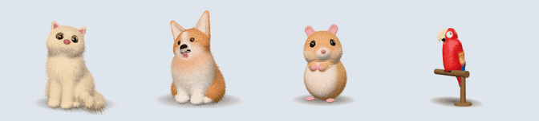 | worked on in the last 2 days: happy crescent eyes and a smile, a little jump now and then, and the odd heart floating up |
| **Content** | 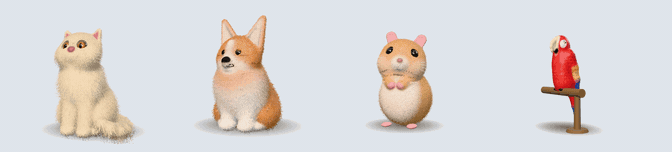 | up to 5 days: relaxed, with slow, trusting blinks |
| **Peckish** | 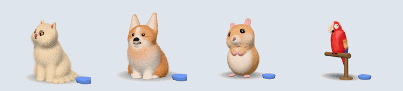 | up to 10 days: an empty bowl appears; it leans towards it, licks its lips and taps it with a paw |
| **Hungry** | 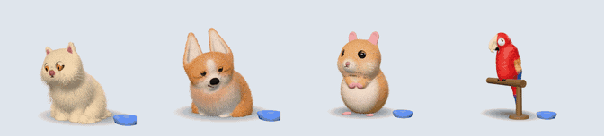 | up to 20 days: it crouches low by the bowl with pleading eyes and a frown, and meows at it |
| **Gloomy** | 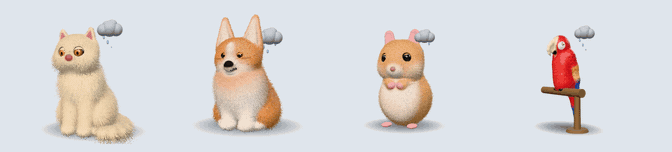 | after that: it lies down (the macaw fluffs up and tucks its head) under its own rain shower, sighing now and then |

Pets never die, age or punish you: a failed sync, an expired token, holidays and paused time never make a mood worse.

### Moments

| | | |
|---|---|---|
| **Fed** | 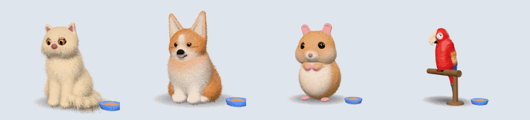 | You pushed: the bowl fills and it eats. |
| **Celebrating** | 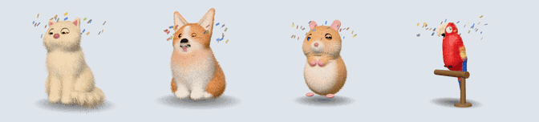 | You marked a release: confetti, then a few days' holiday off-screen. |
| **Back from holiday** | 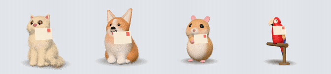 | It comes back with a postcard. |
| **Asleep** | 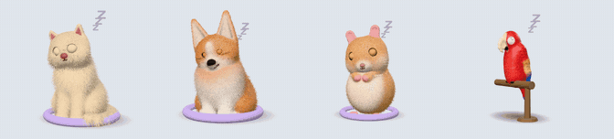 | Snoozed: curled up in its bed (the macaw sleeps on its perch) until it wakes. |
| **Graduated** | 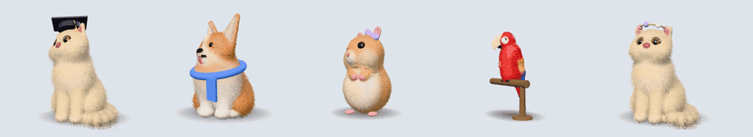 | You finished the project: it puts on its reward (cap, scarf, bow, star badge or flower crown), says goodbye and frees a slot. |

These GIFs are recorded from the app's own 3D pets by [`app/scripts/readme-media.mjs`](app/scripts/readme-media.mjs).

## How it works

- **One pet per project.** Pick a cat, dog, hamster or parrot for each repository or project folder. By default you can keep 3 pets (configurable); other projects wait in a shelter, and you're offered the next one when a slot opens.
- **Mood follows your activity** (see [Moods](#moods)). Holidays and paused time don't count, and weekends can be excluded.
- **Releases.** Mark a release and the pet celebrates, then takes a few days off-screen.
- **Snooze and pause.** Snooze hides a pet for a while (its hunger keeps counting). Pause is for deliberate breaks (its hunger freezes). Vacation mode pauses everyone.
- **Stays out of your way.**
  - Clicks pass straight through pets. Hold **⌥ Option** to interact.
  - Pets move aside for your frontmost window, hide over full-screen apps, and stay out of screen recordings and screen sharing.
  - At most 3 are on screen at once, neediest first.
  - Liveliness sets how smoothly pets move: **Calm**, **Gentle** (the default) or **Lively**, at a higher CPU cost each. A pet can have its own in its card's Pet settings.

| Input | Action |
|---|---|
| ⌥ + hover | Pets glow and stay put, this one gets an outline and shows name · repo · mood |
| ⌥ + click | Open the pet's info card: mood, activity, goal checklist, and sync, snooze, release, pause, graduate |
| ⌥⇧ + click | Sync this pet now (a turning ↻ shows on every pet while GitHub is being checked) |
| ⌥ + drag | Move the pet onto a grid spot it keeps, on any display |
| ⌥ + right-click | The pet's own menu |
| ⌥ + press and hold | Pet it (it enjoys it; mood only changes with work) |

The modifier key can be changed in Settings, which also has an optional shortcut to hide or show every pet, and an optional soft piano loop while a pet is gloomy (off by default). Every action is also in the 🐾 menu-bar menu.

See the [user guide](docs/user-guide.md) for setup, connecting GitHub, folders and removing the app.

## Privacy and permissions

Strays is local-first and asks for as little as possible.

- **No network** except GitHub, and only once you connect a token, check for a new version (Settings → About: Check now, or the opt-in weekly check; neither sends a token), or download one.
- **Updates in two clicks.** Settings → About: Check now, then Download and install saves the new version to Downloads and opens it; quit Strays and drag it onto Applications. The sandboxed app never replaces itself.
- **Read-only, expiring GitHub token.** A fine-grained token with only **Metadata: Read-only**: it can see when repos were pushed to, not their code. Classic tokens are rejected. The token is kept in the macOS Keychain and never reaches the app's web view.
- **Only `api.github.com`.** No other host is contacted, and redirects are never followed. The one exception is opt-in: anonymous error reports to PostHog, off until you turn them on: an error code only, never a message, name or path.
- **No `git` commands.** Local repositories are read directly (commit dates and remote URLs only). Strays never fetches, and never touches your credentials or SSH keys.
- **No special macOS permissions.** Cursor position, the ⌥ key and window bounds are all readable without Accessibility, Input Monitoring or Screen Recording.

## Architecture

```
app/core        Rust library: moods, pet states, settings, storage, GitHub client, local git, display rules.
                No Tauri dependency, so every rule is tested with a fake clock.
app/src-tauri   Tauri 2 app shell: background sync loop, Keychain, menu-bar menu, overlay window, macOS calls.
app/src         Overlay page and windows (TypeScript): the info card, settings, token setup and adoption screens.
app/src/pet3d   The 3D pets (three.js): each species is built from distance-field shapes on a small skeleton,
                with shell-rendered fur or feathers, painted eyes, props and accessories; shapes are meshed
                in a worker. If a Mac can't draw WebGL, the Rive 2D pets below stand in.
art/<species>   The 2D fallback rigs, generated as text (RML) by Python scripts and compiled with the Rive CLI.
tools/          Fake GitHub API server and an OS-level click-test harness.
native-overlay  Swift prototype from Gate 0, kept as a performance fallback.
docs/           Specification and gate reports.
```

The Rust side owns all state and decisions. The web view only renders what it's told and reports ⌥-clicks. State is stored as JSON files, written atomically, in the app's data folder.

## Development

**Prerequisites:** macOS 14+, Xcode Command Line Tools, Rust (stable), Node.js 22, Python 3 (tests only), and the [Rive CLI](https://rive.app) to rebuild art.

```bash
# Build the pet art (writes art/<species>/build/<species>.riv, which the app bundles)
for s in cat dog hamster parrot; do (python3 art/$s/make.py && cd art/$s && rive . --screenshot --advance=1); done

# Install front-end dependencies
cd app && npm install

# Core logic tests (unit, property and fake-GitHub tests)
cd app/core && cargo test

# Debug build of the app, with test hooks
cd app && npx tauri build --debug --no-bundle --features devtools
```

### Running a debug build

Debug builds read a GitHub token from `~/.config/strays/dev-token` when the Keychain has none. These variables exist only in debug builds:

| Variable | Effect |
|---|---|
| `STRAYS_DATA_DIR=<dir>` | Use a throwaway data folder |
| `STRAYS_SPAWN=<n>` | Add n test cats (not saved) |
| `STRAYS_FAKE_GITHUB=<url>` + `STRAYS_TOKEN=github_pat_fake` | Sync against `tools/fake-github/server.py` (needs `--features devtools`) |
| `STRAYS_CAPTURABLE=1` | Let screenshots capture the pets |
| `STRAYS_IGNORE_FRONT=1` | Pin placement, for repeatable performance runs |

```bash
STRAYS_DATA_DIR=/tmp/strays STRAYS_SPAWN=3 app/src-tauri/target/debug/Strays
```

### OS-level tests

```bash
tools/overlay-harness/click-test.sh   # real mouse and ⌥ events against the debug build
tools/overlay-harness/perf.sh B 600   # CPU and memory sample (set APP to the binary)
```

The click test takes over the mouse and keyboard for about a minute. It needs Accessibility access for the app that runs it, and the harness binary must be built first: `swiftc -O tools/overlay-harness/harness.swift -o tools/overlay-harness/harness`.

## Roadmap

Development runs through gates, each with measurable pass criteria (see [`docs/spec.md`](docs/spec.md) §14).

| Gate | Scope | Status |
|---|---|---|
| 0 | Prove the stack: Rive art authored by an agent, click-through overlay, CPU cost | ✅ Done ([report](docs/gate-0.md)) |
| 1 | Core logic, GitHub sync, local git | ✅ Done ([report](docs/gate-1.md)) |
| 2a | App shell, menu bar, sync loop, overlay | ✅ Done ([report](docs/gate-2.md)); Calm CPU budget set at ≤ 1.5% |
| 2b | Info card, settings, token setup, first run, local folders, nudges | ✅ Done ([report](docs/gate-2b.md)) |
| 3 | All four species, full animation set, sound, writing | In progress ([report](docs/gate-3.md)): cat, corgi and hamster done; parrot next |
| 4 | Signing, notarisation, packaging, release | Planned |

Windows support and cross-device sync are planned after the macOS release.

## License

[MIT](LICENSE), code and art. The sounds in `assets/audio` are CC0 recordings from Freesound; see [their credits](assets/audio/CREDITS.md). The film's music (`docs/media/strays-launch.mp4`) is "Happy Beats / Business Moves Vol. 1" by Sascha Ende ([ende.app](https://ende.app/en)), CC BY 4.0, not covered by the MIT licence; its other sound effects are CC0 (Kenney).
